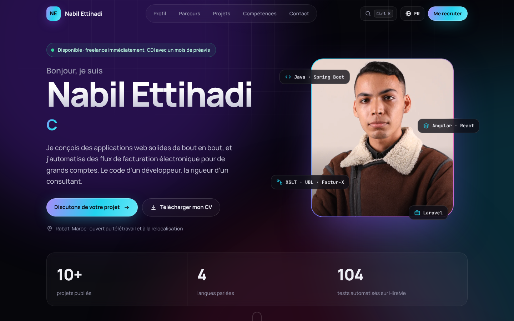
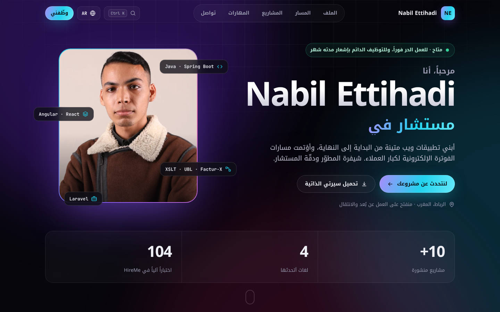

# Portfolio · Nabil Ettihadi

Développeur Full-Stack (Java/Spring Boot, Angular, React, Laravel) et consultant technico-fonctionnel en facturation électronique.

**En ligne : https://nabilettihadi.github.io/Nabil-Ettihadi-Portfolio/**



## Ce qu’il y a dedans

- **13 langues** : français, anglais, allemand, espagnol, italien, néerlandais, danois, tchèque, estonien, grec, russe, ukrainien et arabe (affiché de droite à gauche). La langue du navigateur est choisie d’office, le choix est mémorisé, et un lien peut forcer une langue (`?lang=de`).
- Projets filtrables (HireMe, Arkade, SyndicNow et projets Java), avec liens vers la démo et le code.
- Parcours en frise, compétences par domaine, langues parlées, contact avec copie de l’adresse et CV en trois langues.
- Palette de commandes (`Ctrl K`) pour naviguer et changer de langue au clavier.
- Animations légères, désactivées si le système le demande ; responsive du mobile au grand écran.



## Technique

React 18, Vite, i18next, CSS sans framework, polices Manrope, JetBrains Mono et Noto Kufi Arabic auto-hébergées.

```
src/
├── App.jsx            sections de la page
├── data.js            projets, parcours, compétences, contact
├── i18n/locales/      un fichier par langue
└── styles.css
```

## Lancer en local

```bash
npm ci
npm run dev
```

## Publication

Le workflow `.github/workflows/deploy.yml` construit et publie le site sur GitHub Pages à chaque push sur `main`.
